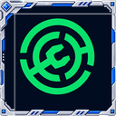
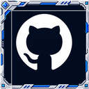

# Fresh Animations Fixes

A small Minecraft 1.21.1 resource pack that fixes problems you get when you run Fresh Animations together with Fresh Animations: Extensions (by FreshLX), Entity Model Features and Entity Texture Features.

## What it fixes
- **Pillager and vindicator hat box.** With Extensions installed, pillagers and vindicators wore a grey or white box on their head, or a dark helmet on every single one. This pack removes that broken helmet part, so they look and animate like they do in plain Fresh Animations (moving nose included).
- **Iron golem cracks.** Golems Refreshed re-rigged for Fresh Animations keeps its animations and its damage cracks (100%, 60%, 20% health) working when the other packs are loaded.
- **Sheep and warm pig textures.** The sheep colour variants and the warm pig texture keep their own look instead of turning white or being replaced when Extensions is loaded.

Witches, evokers, wandering traders, piglin brutes, cows, pigs and villagers were checked and are unaffected.

## What the public download covers
Only the pillager and vindicator fix: two edited model files plus the icon. These are edited copies of FA Extensions models, shared as a remix with credit to FreshLX.

The golem, sheep and warm pig parts are **not** in the public download. Golems Refreshed + Fresh Animations is All Rights Reserved by its author (lukidonu), so its textures cannot be redistributed here. For the golem fix, install the author's own "Golems Refreshed + Fresh Animations" and "Golems Refreshed" packs and put them below this pack. The pillager fix works on its own either way.

## Install
1. Install Fresh Animations and Fresh Animations: Extensions by FreshLX, plus Entity Model Features and Entity Texture Features.
2. Drop the zip into your `resourcepacks` folder.
3. Order, bottom to top: Fresh Animations, Fresh Animations: Extensions, (Golems Refreshed packs, optional), **Fresh Animations Fixes** on top.

## How it works
Extensions adds a helmet part to the pillager and vindicator models. Its texture file is an empty placeholder and the real helmet art only exists as a random variant, so the game draws the part with the wrong texture. This pack ships the same two models with that helmet part removed.

## Credits and licence
- Fresh Animations and Fresh Animations: Extensions by FreshLX (find them on Modrinth). Edited models are a remix under their terms, with credit. Their packs are not included; install them separately.
- Golems Refreshed by lukidonu: not included.
- Made with AI assistance.

## Got an idea?
Found a problem, or want another fix? Tell me and it gets looked at; ideas are welcome too.

