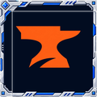

<picture></picture>

 

<picture></picture>

<picture></picture>

With Fresh Animations: Extensions (by FreshLX) installed, pillagers and vindicators wore a grey or white box on their head. This pack removes that broken helmet part, so they look and animate like they do in plain Fresh Animations, moving nose included.

<picture></picture>

Golems Refreshed re-rigged for Fresh Animations keeps its animations and its damage cracks (100%, 60%, 20% health) working when the other packs are loaded. The golem part is not in the public download: install the author's own packs and put them below this one.

<picture></picture>

Sheep colour variants and the warm pig texture keep their own look instead of turning white or being replaced.

Witches, evokers, wandering traders, piglin brutes, cows, pigs and villagers were checked and are unaffected.

<picture></picture>

<picture></picture>

Needs Fresh Animations, Fresh Animations: Extensions by FreshLX, Entity Model Features and Entity Texture Features. Put this pack on top.

Suggest a feature or report a bug on GitHub Issues, or in the comments.

Fresh Animations and Fresh Animations: Extensions by FreshLX; edited models are a remix with credit. Golems Refreshed by lukidonu is not included. Made with AI assistance.

